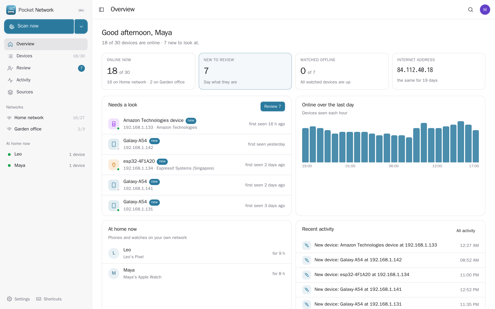
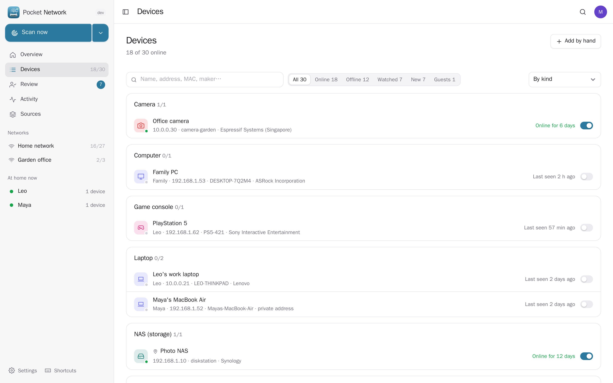
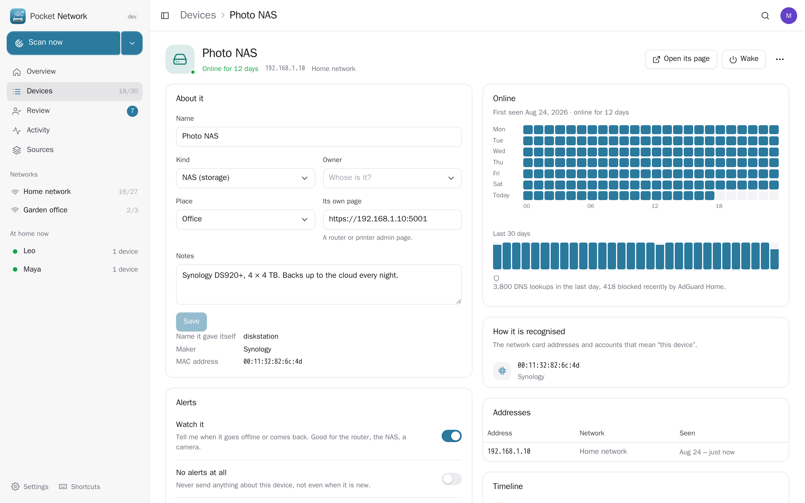
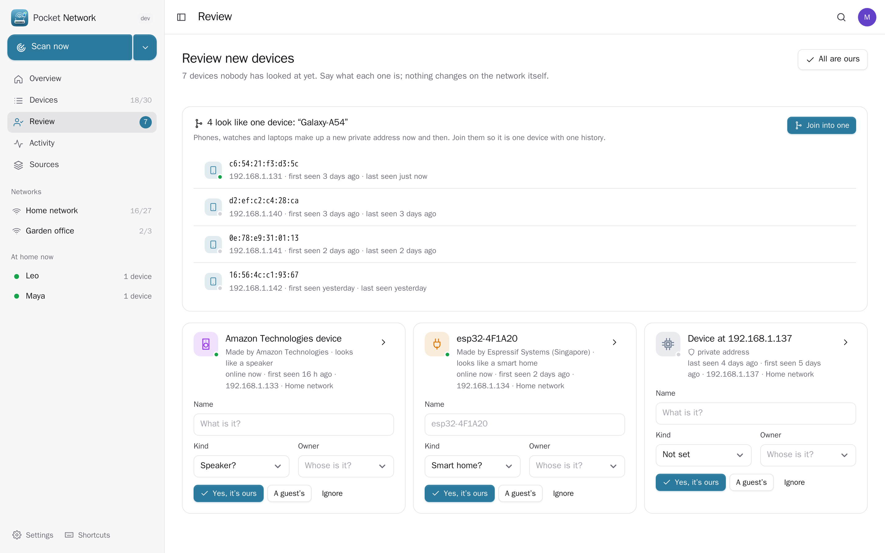
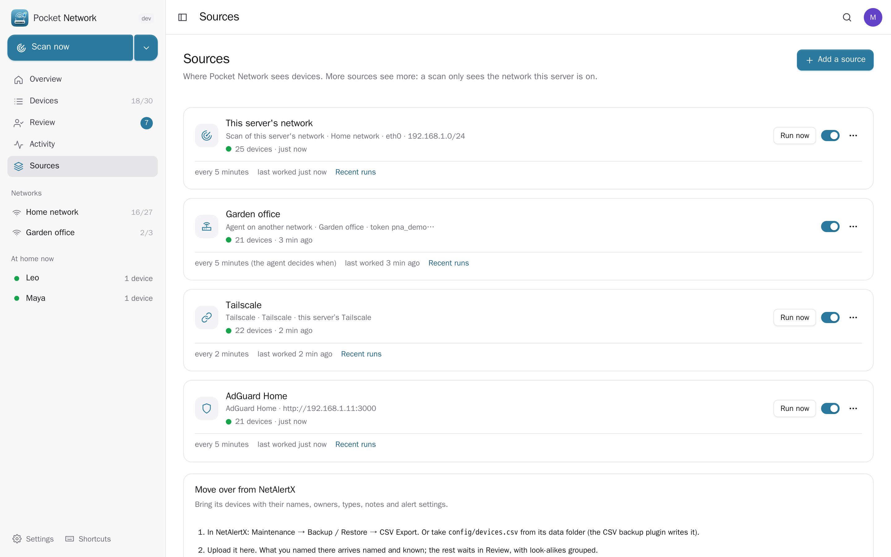
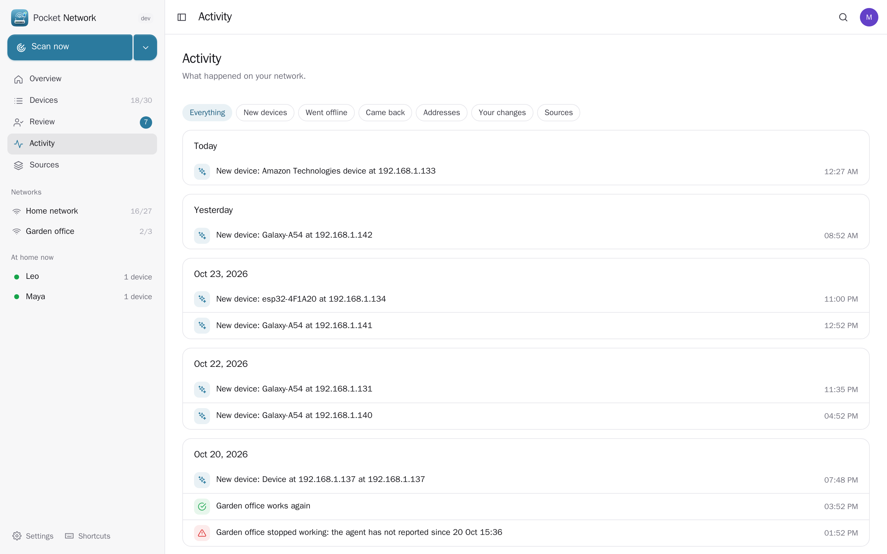
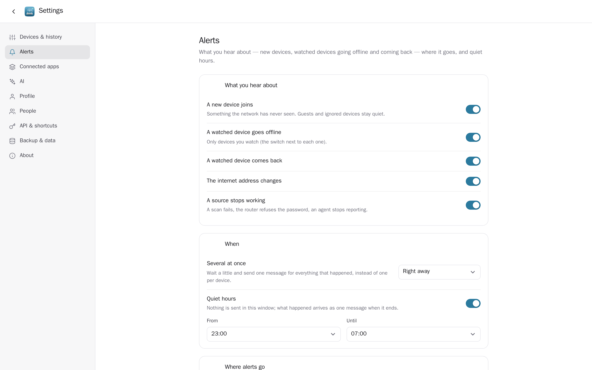
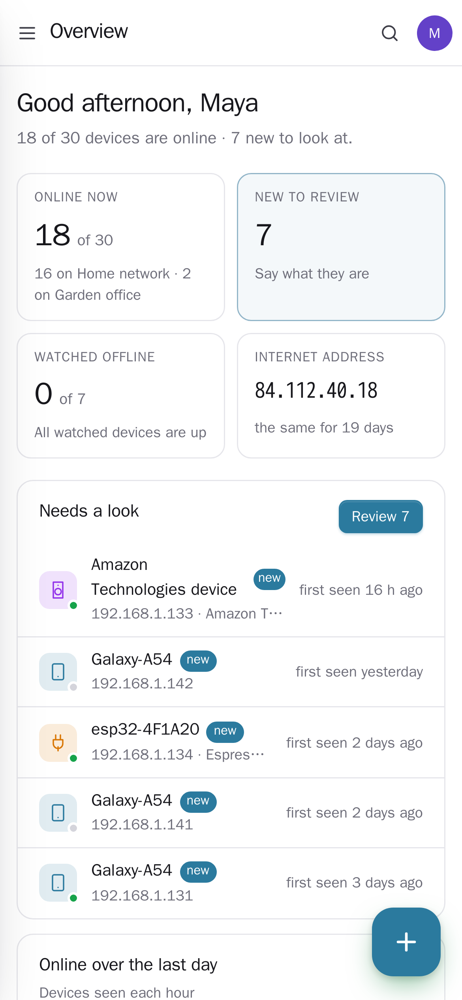
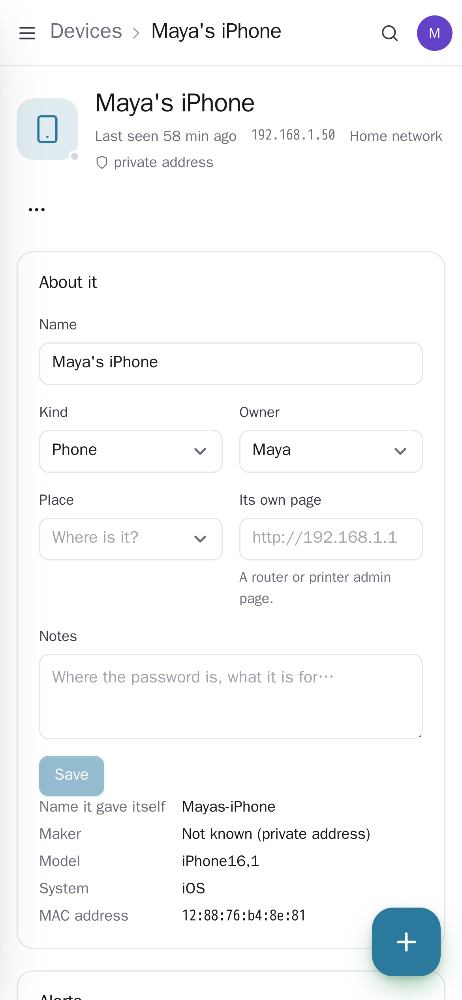
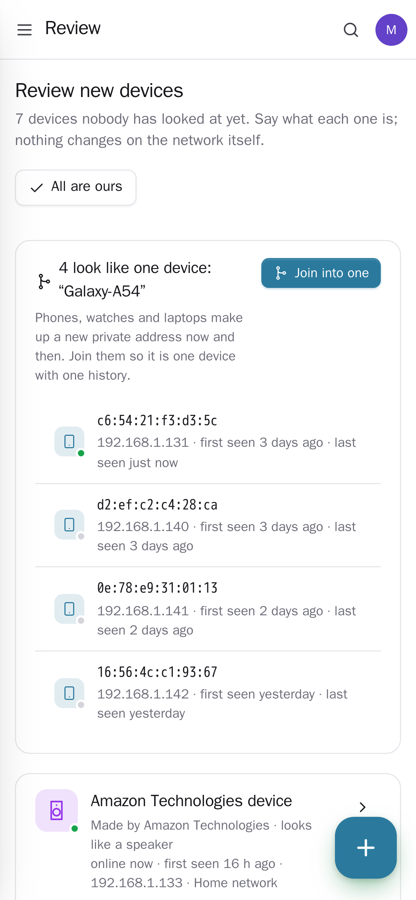

<p align="center"></p>
<h1 align="center">Pocket Network</h1>
<p align="center">Every device on your home network, in one list you can actually read. It scans the network in pure Go (ARP plus mDNS, NetBIOS and reverse-DNS names), and adds what it can't see from Tailscale, AdGuard Home, an OpenWrt router and small agents on networks behind other routers. New devices wait in a simple review — is this yours, a guest's, or ignore it — and phones that keep making up new private addresses are recognised as the same phone. You get online history for every device, alerts when something new joins or a device you watch drops off, Wake-on-LAN, and links to the item in Pocket Inventory and the server in Pocket Monitoring. It replaces NetAlertX and imports its device list.<br>One Go binary, one SQLite file, one volume. Part of the Pocket apps; works on its own too.</p>
<p align="center">
  <a href="https://github.com/abjelosevic88/pocket-homelab-network/actions"></a>
  <a href="https://github.com/abjelosevic88/pocket-homelab-network/pkgs/container/pocket-homelab-network"></a>
  <a href="LICENSE"></a>
</p>

---

<p align="center"></p>

<table>
  <tr>
    <td width="50%"></td>
    <td width="50%"></td>
  </tr>
  <tr>
    <td align="center"><sub>Every device, grouped by kind, owner, place or network. The switch watches it.</sub></td>
    <td align="center"><sub>One device: what it is, whose, when it was online, how it is recognised, what it answers on.</sub></td>
  </tr>
  <tr>
    <td width="50%"></td>
    <td width="50%"></td>
  </tr>
  <tr>
    <td align="center"><sub>Review: look-alikes are grouped to join first, then “is this yours?” for the rest.</sub></td>
    <td align="center"><sub>Sources: a scan here, an agent behind another router, Tailscale, AdGuard Home, OpenWrt.</sub></td>
  </tr>
  <tr>
    <td width="50%"></td>
    <td width="50%"></td>
  </tr>
  <tr>
    <td align="center"><sub>Activity, by day: new devices, outages, new addresses, sources that failed.</sub></td>
    <td align="center"><sub>Alerts through Apprise, ntfy or a webhook, gathered into one message, never in quiet hours.</sub></td>
  </tr>
</table>

<p align="center">
  &nbsp;&nbsp;
  &nbsp;&nbsp;
  
</p>

## What it does

- **Finds devices** with an ARP sweep in pure Go (raw sockets on Linux; the system ARP table elsewhere or without the permission), asks each one its name over mDNS (and its model, for Apple devices), NetBIOS and reverse DNS, looks the maker up from the MAC address (an embedded IEEE list) and guesses what kind of device it is.
- **Sees past the scan**: your **Tailscale** peers at home or away (from this server's tailscaled or the API; a laptop's Tailscale entry and its LAN entry become one device), **AdGuard Home** client names and DNS activity, an **OpenWrt / GL.iNet** router's DHCP leases, Wi-Fi clients and ARP table, and **agents** — `pocket-network-agent`, a small binary for a computer or router on another network (ARM and MIPS included) that reports in, so nothing has to reach it.
- **Review**: new devices wait until you say what they are. Name, kind and owner in one card, then *Yes, it's ours*, *A guest's* (no alerts when it leaves, forgotten after a while away) or *Ignore*. An AI can guess what an unknown device is from its maker, name, services and online pattern.
- **Phones that change their address**: phones, watches and laptops make up new private MAC addresses. One with the same name as a device you have joins that device instead of showing up as new; look-alikes from before are grouped in the review to join with one tap.
- **History**: online minutes per hour for every device (a week grid and the last 30 days), devices online over the last day, a per-device timeline, who is home now (phones and watches on your own network), your public internet address and when it changed.
- **Alerts** through Apprise, ntfy or a webhook: a new device, a watched device going offline or coming back, the internet address changing, a source failing. Gathered into one message if you like, held during quiet hours. A failing scan never sets off a wave of "offline" alerts: devices are only judged by sources that work.
- **On a device**: Wake-on-LAN, a check of which common services it answers on (with a link to its web page), joining two entries that are one device, its item in Pocket Inventory (bought, warranty, where it lives) and its health in Pocket Monitoring.
- **Moving over from NetAlertX**: upload its `devices.csv` — names, owners, types, notes, favourites and alert settings come along; importing again only fills in what is empty.
- **Everyone their own**: each person has their own devices, sources and alerts; admins see no one else's. Only admins can scan the server's own networks.

## Run it

Scanning a LAN needs host networking (a bridged container only sees its own Docker network) and, for the fast ARP sweep, `NET_RAW`:

```sh
docker run -d --name pocket-network --network host --cap-add NET_RAW -v ./data:/data \
  -e PORT=8080 -e BASE_URL=https://network.example.com -e SECURE_COOKIES=true \
  -v /var/run/tailscale/tailscaled.sock:/var/run/tailscale/tailscaled.sock:ro \
  ghcr.io/abjelosevic88/pocket-homelab-network:latest
```

or `docker compose up -d` with [docker-compose.yml](docker-compose.yml). Create the first account: a scan of the server's network (and its Tailscale, when the socket is mounted) starts by itself. A network behind another router: Sources → Add → Agent gives you the command. All options: [docs/configuration.md](docs/configuration.md). API: [docs/api.md](docs/api.md).

## With Pocket Core

Set `CORE_URL` and `CORE_REGISTRATION_KEY` and Network joins the box: people sign in with Pocket Core, a device links to its item in Pocket Inventory (`items:read`) and its server in Pocket Monitoring (`monitoring:read`) with nothing to paste, AdGuard Home comes from each person's own login in Core, and Pocket AI answers "what could this be?". Other Pocket apps can read your network (`network:read`: Pocket Day, Pocket AI, Pocket Hub) or add and describe devices (`network:write`). Events on the bus: `network.device_new`, `network.device_offline`, `network.device_back`, `network.wan_ip_changed`. Without Core every connection can be made directly with a URL and a token; the Core-only choices stay visible, greyed out.

## Develop

```sh
make dev     # API on :8080 with demo data + Vite on :5173
make test    # go vet, go test, tsc
make         # web + binary
make oui     # refresh the embedded MAC vendor list
```

MIT licensed. Scanning only touches the networks you point it at; the service check knocks once on a few common ports, and only on private addresses.
